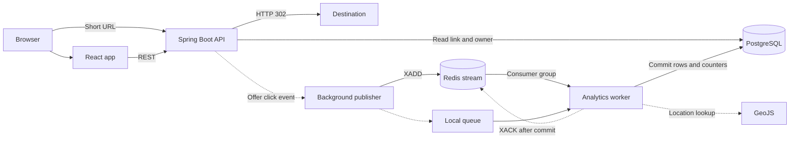

# Linkly documentation

## Product overview

Linkly is a web app for publishing a public link page and measuring traffic on short URLs. An account owner creates links, selects their order, and decides which links appear on their profile. Visitors can open a profile or follow a short link without an account. Owners can optionally publish a UPI payment QR and let visitors send messages. Linkly displays payment instructions through the QR and does not process payments.

The dashboard shows per-link click totals, estimated unique visitors, device and browser breakdowns, country estimates, and a 30-day click history. The inbox and detailed analytics are private to their owner. Administrators can inspect service health, adjust Redis usage and self-ping, and suspend or remove accounts.

## System layout

| Component | Responsibility |
| --- | --- |
| React and Vite on Vercel | Public pages, dashboard, settings, inbox, and admin interface. Vite proxies local development requests to Spring Boot. |
| Spring Boot on Render | REST API, authentication, redirects, link and account operations, and a scheduled analytics worker. |
| PostgreSQL on Supabase | Source of truth for accounts, links, messages, analytics events, and runtime settings. Flyway manages migrations. |
| Redis Streams on Upstash | Queue for click events. Linkly can run with a bounded local queue when Redis is unavailable. |
| GeoJS | Optional country and city enrichment for public IP addresses on click events. |

## User flows and API

| Flow | API or route | Access |
| --- | --- | --- |
| Register or sign in | `POST /api/auth/register`, `POST /api/auth/login` | Public |
| View a profile | `/p/{username}`, backed by `GET /api/public/u/{username}` | Public |
| Follow a short URL | `GET /r/{code}` | Public |
| Send a message | `POST /api/public/u/{username}/messages` | Public when the creator enables messages |
| Create, edit, reorder, or remove links | `/api/links`, `/api/links/{id}`, `/api/links/reorder` | Owner |
| Read dashboard and analytics | `GET /api/links/dashboard`, `GET /api/links/{id}/analytics` | Owner |
| Read or delete inbox messages | `GET /api/messages`, `DELETE /api/messages/{id}` | Owner |
| Edit account settings or revoke sessions | `PUT /api/users/settings`, `POST /api/users/me/revoke-sessions` | Owner |
| Manage accounts and service settings | `/api/admin/users`, `/api/admin/system/health`, `/api/admin/system/settings` | Administrator |

[OpenAPI explorer](https://linkly-amwf.onrender.com/swagger-ui/index.html)

### Links and profiles

A link contains a display title, destination URL, short code, active flag, and sort position. Linkly accepts HTTP and HTTPS destinations and can generate a code or use a custom alias supplied by the owner. A uniqueness constraint on the code resolves collisions. A creator can keep a link for later by disabling it. The public profile returns active links in the creator’s chosen order and excludes private account fields and click counts.

### Redirects and analytics

1. The request passes a per-IP limit. A database lookup reads the destination and the current link and owner status. Invalid or disabled links lead to a frontend error page. Valid links return HTTP `302` with `Cache-Control: no-store`. Unicode path and query characters are encoded for the `Location` header. HEAD requests resolve the destination without recording a click.
2. For a GET request from a visitor, the application offers a click event with a stable UUID to a bounded background executor. Recognized bots and preview clients are skipped. The publisher uses Redis `XADD`, or places the event in a local queue when Redis is unavailable or the executor is saturated.
3. The scheduled worker checks local work every two seconds by default. It checks Redis when this instance publishes or when a periodic sweep is due. Redis pending entries are read before fresh entries. The fixed consumer name lets a replacement process on the same single-instance deployment pick up pending work.
4. The worker looks up uncached public IPs with GeoJS before opening a database transaction. Timeouts and provider failures leave the location unknown and pause fresh lookups temporarily. The click can still be stored.
5. PostgreSQL inserts events using `ON CONFLICT (id) DO NOTHING` and updates link counters for the rows inserted by the same transaction. After the transaction commits, the worker acknowledges the batch. If the acknowledgement is lost, the next delivery does not increment the counter again.

Source entry points include [LinkService](src/main/java/com/gupta/linkly/service/LinkService.java), the [stream worker](src/main/java/com/gupta/linkly/analytics/ClickStreamWorker.java), and the [batch writer](src/main/java/com/gupta/linkly/analytics/ClickBatchWriter.java).

### Accounts and inbox

Passwords are hashed with BCrypt. The database enforces case-insensitive uniqueness for usernames and email addresses. The API verifies the token signature, expiry, account UUID, token version, and account state. Private link and message queries use that UUID. Password changes, global sign-out, and suspension advance the version, invalidating older tokens. The frontend stores the bearer token in local storage.

Anonymous messages go only to a creator with messaging enabled. An inbox request returns a page of newest messages first. To fetch older messages, supply both `before` and `beforeId` from the last item on the previous page. The timestamp and message UUID together give a stable order when timestamps match.

## Database and privacy

| Table | Stores |
| --- | --- |
| `users` | Account details, BCrypt hashes, role, suspension state, and token version |
| `links` | Destinations, aliases, sort positions, activity flags, and aggregate click counts |
| `click_analytics` | Event UUID, link ID, click time, device, browser, location, and keyed IP hash |
| `messages` | Sender label, message body, owning account, and creation time |
| `system_settings` | Redis and backend self-ping settings |

Foreign keys cascade deletions from accounts to their links and messages, and from links to their click rows. The inbox has a composite cursor index. Click history is aggregated in SQL, and older history increases query work. Flyway V1–V7 establish the schema, add row-level security, enforce case-insensitive identities, correct legacy account flags, and index inbox pagination. The PostgreSQL migration connection uses a session advisory lock so V4 can update Flyway’s history table. [Migration files](src/main/resources/db/migration)

Unique visitors are estimates based on a keyed IP hash. Users sharing an IP can be counted together, and changing addresses can count the same visitor more than once. Redis events can contain raw IPs while queued. With location lookup enabled, GeoJS receives public visitor IPs. Changing location settings affects new clicks, and stored events keep their existing location values.

## Configuration and deployment

| Platform | Setup |
| --- | --- |
| Supabase | Use the **Session pooler** JDBC endpoint on port 5432. Set `DB_URL`, `DB_USERNAME`, and `DB_PASSWORD` on Render. Back up before migrating and check case-only duplicates in usernames and emails when upgrading from a pre-V5 database. |
| Render | Build the repository root with Docker. Set a strong `JWT_SECRET` and set `FRONTEND_URL` to the Vercel origin. Use `/actuator/health/liveness` for the service health check. Keep `IP_HASH_SALT` stable if set. |
| Upstash | Copy the connection URL from **Connect → TCP** into `REDIS_URL`. Use the TLS `rediss://` URL and preserve the queue across deploys. |
| Vercel | Set the root directory to `frontend` and `VITE_BACKEND_URL` to the public Render URL. Leave `VITE_SHORT_LINK_BASE_URL` unset to send short links directly to Render. |

Location lookup is enabled by default. Set `GEOIP_ENABLED=false` to disable it. On the public Render service, `TRUST_CLOUDFLARE_CLIENT_IP=true` lets Linkly use the visitor address provided by the Render edge. Enable header trust only where that edge overwrites the header. Other deployments can select a trusted position from the right of `X-Forwarded-For` with `TRUSTED_PROXY_COUNT`. Direct local requests use the socket address. [Render edge header guidance](https://render.com/articles/host-pocketbase-on-render) · [GeoJS API](https://www.geojs.io/docs/v1/endpoints/geo/)

### Health and troubleshooting

| Symptom | Check |
| --- | --- |
| Sign-in is waiting | Check `/actuator/health/readiness` on Render. The login page polls readiness, including PostgreSQL. A paused Supabase database can keep readiness down after the backend starts. |
| Click queue is unavailable | Verify Upstash is active and `REDIS_URL` matches the TCP connection URL. Inspect the authenticated `GET /api/admin/system/health` response for component details. |
| Analytics counts are delayed | Check the stream backlog and whether the local queue is filling. Open a link from a browser to avoid filters for bots or link previews. |
| Location analytics is waiting for traffic | Send a new click from a regular browser on a public network. The provider status changes after a lookup response. Private addresses and unresolved locations do not produce country estimates. |

## Operational limits

The current deployment runs one application instance. In-memory queues can lose events when full or on restart. Redis stream retention can drop unprocessed work during prolonged backlogs, and a repeatedly failing database batch can stall the consumer until the underlying problem is fixed. Malformed records are acknowledged and counted. Multiple workers would need consumer-specific identities, pending-entry recovery, and a shared rate limit. Current tests exercise transactions and application behavior. Capacity and uptime depend on the hosting environment.
