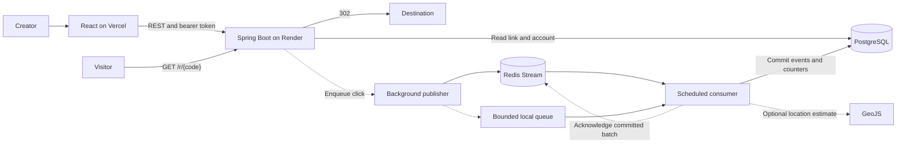

# Linkly project documentation

## Architecture

Linkly runs one Spring Boot process and a React single-page app. Vercel serves the frontend. Render runs the API and the scheduled analytics worker. PostgreSQL on Supabase stores accounts, links, inbox messages and analytics. Upstash Redis carries click events when available. Spring Security protects private routes and Flyway versions the schema.

| Follow this flow | Read these classes |
| --- | --- |
| Login | [AuthController](src/main/java/com/gupta/linkly/controller/AuthController.java) → [AuthService](src/main/java/com/gupta/linkly/service/AuthService.java) → [JwtUtil](src/main/java/com/gupta/linkly/security/JwtUtil.java) |
| Protected API | [SecurityConfig](src/main/java/com/gupta/linkly/security/SecurityConfig.java) → [JwtAuthenticationFilter](src/main/java/com/gupta/linkly/security/JwtAuthenticationFilter.java) → service and repository |
| Short link | [RateLimitingFilter](src/main/java/com/gupta/linkly/security/RateLimitingFilter.java) → [RedirectController](src/main/java/com/gupta/linkly/controller/RedirectController.java) → [LinkService](src/main/java/com/gupta/linkly/service/LinkService.java) |
| Click storage | [ClickEventPublisher](src/main/java/com/gupta/linkly/analytics/ClickEventPublisher.java) → [ClickStreamWorker](src/main/java/com/gupta/linkly/analytics/ClickStreamWorker.java) → [ClickProcessor](src/main/java/com/gupta/linkly/analytics/ClickProcessor.java) → [ClickBatchWriter](src/main/java/com/gupta/linkly/analytics/ClickBatchWriter.java) |
| Public profile and inbox | [PublicController](src/main/java/com/gupta/linkly/controller/PublicController.java) → [UserService](src/main/java/com/gupta/linkly/service/UserService.java) and [MessageService](src/main/java/com/gupta/linkly/service/MessageService.java) |

## From a browser click to an analytics row

1. Bucket4j uses a per-IP token bucket backed by a bounded Caffeine cache. The resolver uses the socket address locally or the configured trust boundary behind a reverse proxy. Linkly's direct public Render deployment can use the `CF-Connecting-IP` header that Render's edge overwrites. Other deployments can configure the number of trusted hops from the right of `X-Forwarded-For`.
2. An indexed PostgreSQL query joins the short link and its owner so Linkly can enforce link activity and account suspensions. Unknown, inactive, or suspended links go to the frontend error page. Valid links return `302` with `Cache-Control: no-store`. HEAD resolves the destination without recording a click.
3. Recognizable bots and browser preview clients skip analytics. Other GETs offer a click with a stable UUID to a bounded executor. It appends to Redis with `XADD` or uses the local buffer when the circuit is open, publishing fails, or the executor queue is full.
4. The worker checks local work every two seconds and polls Redis after a publish signal or a periodic sweep. It reads pending entries before new ones. The fixed consumer name lets a replacement process on the current single-instance deployment see earlier pending events.
5. When enabled, the worker batches public IPs to GeoJS before opening a database transaction. Lookups are cached and temporary provider failures pause new requests. Click analytics continue with an unknown location where needed.
6. PostgreSQL inserts events using `ON CONFLICT (id) DO NOTHING`. A CTE increments each link counter for newly inserted events in the same transaction. The worker acknowledges Redis following commit. If the acknowledgement fails, the next delivery leaves the already-committed counter intact.

A crash can lose events still queued in memory. Redis retention can trim unprocessed entries during a prolonged backlog. Invalid stream entries are counted and acknowledged. Valid entries that fail database processing are retried. A persistent failing entry needs operator investigation.

## Accounts, data, and privacy

- Registration uses BCrypt and enforces the 72-byte password limit. PostgreSQL enforces case-insensitive identity uniqueness. JWTs identify an immutable account UUID and carry the token version. Authenticated requests load the account and check its token version and suspension state. Owner checks and admin roles are enforced on the server.
- The browser stores the JWT in local storage, which a script executing on the frontend origin could read. Public profiles expose selected display fields and active links. Anonymous messages are sent to the creator's private inbox, which uses `(created_at, id)` as its pagination cursor.
- The database stores a keyed hash of each visitor IP for approximate visitor counts. Shared IPs and changing IPs affect the estimate. Redis may hold raw IPs in queued events. With location analytics enabled, GeoJS receives public IPs from click events. Existing click rows keep their original location data.
- Foreign keys cascade from accounts to links and messages, and from links to click rows. Analytics statistics use SQL aggregation, so long histories increase query cost.
- Flyway V1–V4 establish the schema, add analytics changes, and enable row-level security. V5 adds case-insensitive uniqueness, V6 fixes legacy nullable flags, and V7 indexes inbox pagination. V4 updates Flyway's history table, so the PostgreSQL connection uses a session advisory lock to avoid a migration stall. [Migration files](src/main/resources/db/migration)

## Deployment

| Platform | Configuration |
| --- | --- |
| Supabase | Use the **Session pooler** JDBC endpoint on port 5432. Configure `DB_URL`, `DB_USERNAME`, and `DB_PASSWORD` on Render. Back up before applying migrations. If upgrading from before V5, check accounts grouped by `lower(username)` and `lower(email)` for duplicates first. |
| Render | Build the repository root with Docker. Set a strong `JWT_SECRET`, the exact Vercel hostname in `FRONTEND_URL`, and the liveness path to `/actuator/health/liveness`. Keep `IP_HASH_SALT` stable if set. |
| Upstash | Copy the full URL from **Connect → TCP** into Render's `REDIS_URL`. It uses `rediss://`. Keep the stream and check quota and eviction settings. |
| Vercel | Set the project root to `frontend` and `VITE_BACKEND_URL` to the public Render URL. Leave `VITE_SHORT_LINK_BASE_URL` unset to send short links directly to Render. |

### Enable location analytics on Render

Location analytics default to enabled. Remove an existing `GEOIP_ENABLED=false` override or set it to `true`. On Linkly's public Render service, set `TRUST_CLOUDFLARE_CLIENT_IP=true` so the worker receives the visitor address instead of an internal proxy address. Enable this trust setting only where incoming requests must pass through an edge that overwrites the header. On other hosts, configure `TRUSTED_PROXY_COUNT` for that host's trusted hops, or leave it at zero for unproxied local requests. [Render's description of its edge headers](https://render.com/articles/host-pocketbase-on-render) · [GeoJS lookup documentation](https://www.geojs.io/docs/v1/endpoints/geo/)

### Verify a deployment

1. Deploy the Render backend and Vercel frontend. Verify liveness and readiness respond successfully and that the Vercel origin can call the API. Login waits for readiness, which includes PostgreSQL. Render may take a minute or two to start after inactivity.
2. Open the public profile while signed out. Log in separately, create a disposable short link and open it in a regular browser. Confirm it redirects and the click appears in Analytics. Test from a public network for a location estimate.
3. In **Admin → System health**, check **Database**, **Click queue**, and **Location analytics**. Location analytics shows **Waiting for traffic** until the provider responds to a batch. For diagnostics, authenticated administrators can inspect component details through `GET /api/admin/system/health`. For an Upstash connection error, recheck the TCP URL and the database's availability in its console.
4. Before sharing an idle demo, confirm the Supabase project is active. Supabase and Render can idle independently.

## Interview walkthrough

Start with a concrete click: find the destination, return the redirect, enqueue the click, and update the counter. Then explain each of these choices in your own words.

| Question | What to explain |
| --- | --- |
| What if PostgreSQL commits but Redis misses the acknowledgement? | The same event UUID on replay hits the unique primary key. The transaction increments the link counter only for inserted rows. |
| Why resolve public links from PostgreSQL? | Each redirect checks the current destination and owner state. The cost is a database round trip. A future cache would need a clear invalidation and staleness policy. |
| What happens when Redis is down? | PostgreSQL still resolves redirects. The circuit breaker avoids repeated connection attempts. The bounded fallback handles some clicks, with a restart and capacity trade-off. |
| How do you revoke JWTs? | Change the account's token version. Each protected request checks the token version against the current account. |
| What would change beyond one backend instance? | Consider shared rate limits, separate consumer identities, pending-entry recovery and load tests before making performance claims. |
| How would you prove a replay is safe? | Run the PostgreSQL integration test that submits a repeated event UUID. Check both the row and aggregate count. |
