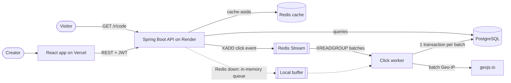

# Linkly

A link-in-bio and URL-shortener platform. Creators get a public page (`/p/{username}`) with their
links, an optional UPI payment QR code and an anonymous message box. Every short link
(`/r/{code}`) records click analytics: country, device, browser, unique visitors and a 30-day trend.

**Live:** [linkly-plum.vercel.app](https://linkly-plum.vercel.app) ·
**API docs:** [Swagger UI](https://linkly-amwf.onrender.com/swagger-ui/index.html)

## Tech stack

| Layer | Technology | Hosted on |
|---|---|---|
| Backend | Java 21, Spring Boot 4.1 (Web MVC, Security, Data JPA), Flyway, Bucket4j, JJWT | Render (Docker) |
| Database | PostgreSQL | Supabase |
| Cache + queue | Redis (cache-aside + Redis Streams), **optional** | Upstash |
| Frontend | React 19, Vite, Recharts | Vercel |
| Tests / CI | JUnit 5, Mockito, Testcontainers, GitHub Actions | |

## Architecture



### Engineering decisions

1. **Redirects never wait on analytics.** `/r/{code}` resolves the URL (Redis hit = no DB query),
   queues a click event and returns `302`. A background worker stores clicks in batches: one batched
   `INSERT` plus one `UPDATE click_count = click_count + n` per link, in a single transaction.
2. **Redis is optional, by design.** All Redis access goes through `RedisGateway`, which has a
   **circuit breaker**: after a failure it stops calling Redis for 30 s, so requests don't wait for
   timeouts. Caches fall back to PostgreSQL, and clicks fall back to a bounded in-memory queue. The
   app starts and passes its integration test with no Redis at all. Admins can switch Redis off at runtime.
3. **At-least-once click processing.** Stream records are acknowledged (`XACK`) only after the DB
   commit. Failed records stay pending and are retried. After 5 attempts they are dead-lettered, so
   one bad record cannot block the queue.
4. **Quota-aware Redis usage.** The worker reads the stream only when this instance published
   something, plus a sweep every 5 minutes. When idle that is about 600 Redis commands a day, against
   about 86,000 for a 1-second polling loop. The stream is capped (`MAXLEN ~10000`).
5. **Revocable stateless auth.** JWTs carry a per-user `tokenVersion`. Changing the password, being
   suspended or "log out of all devices" bumps it, so every older token stops working.
6. **Security basics done properly.** BCrypt passwords; the current password is required to change
   the email or password. Per-IP rate limits use bounded memory. The client IP comes from the
   *right-most* trusted `X-Forwarded-For` hop (the left side can be forged). Only `http(s)` URLs are
   accepted. Visitor IPs are stored as salted HMAC hashes, and errors never leak internals.
7. **Schema owned by Flyway.** Hibernate never alters tables at runtime (`ddl-auto=none`). The
   integration test validates entities against the migrated schema.

See [docs/ARCHITECTURE.md](docs/ARCHITECTURE.md) for request flows and trade-offs, and
[docs/DEPLOYMENT.md](docs/DEPLOYMENT.md) for the production setup.

## Admin features

The admin dashboard shows **live system health**, refreshed every 30 s:
- PostgreSQL: latency and connection pool
- Redis: ping latency and circuit breaker state
- Click pipeline: mode, stream length and pending count, processed, dropped and dead-lettered counts
- Geo-IP API, self-ping and JVM memory

It also has **runtime switches** for the Render self-ping and for Redis. Both are stored in the
database, so they survive restarts. Admins can also suspend or delete users.

## Running locally

Prerequisites: Java 21, Node 22, PostgreSQL. Redis is optional.

```bash
cp .env.example .env      # then set JWT_SECRET (openssl rand -hex 32) and DB credentials
createdb linkly
./run.sh                  # backend :8080, frontend :5173
```

Flyway creates the schema on first start. Set `ADMIN_PASSWORD` in `.env` to get an `admin` account.

## Tests

```bash
./mvnw test
```

- **Unit tests:** circuit breaker, click publisher fallback, stream worker ack/retry/dead-letter,
  client-IP resolution, User-Agent parsing, and the link/user services.
- **Integration test:** boots the whole app against a real PostgreSQL (Testcontainers) **with no
  Redis**, and runs register → create link → redirect → click recorded → admin health. It needs
  Docker, or `TEST_DB_URL` pointing at an empty database. Without either it is skipped.

CI (GitHub Actions) runs the backend tests and the frontend lint and build on every push.

## API overview

| Method | Path | Auth |
|---|---|---|
| POST | `/api/auth/register`, `/api/auth/login` | public (10/min per IP) |
| GET | `/api/public/u/{username}` | public (60/min per IP) |
| POST | `/api/public/u/{username}/messages` | public (5/min per IP) |
| GET | `/r/{code}` | public (120/min per IP) |
| CRUD | `/api/links`, `/api/links/{id}/analytics`, `/api/links/reorder` | user |
| GET/PUT | `/api/users/profile`, `/api/users/settings`; POST `/api/users/me/revoke-sessions` | user |
| GET/DELETE | `/api/messages` | user |
| GET/PUT | `/api/admin/users…`, `/api/admin/system/health`, `/api/admin/system/settings` | admin |
| GET | `/actuator/health` (`/liveness`, `/readiness`) | public, no details |

## Known limitations / next steps

- Rate limits and the fallback click queue live in one JVM. Running several instances would need
  Redis-backed buckets, and events in the in-memory queue are lost on restart.
- Short links use the backend's Render domain. A custom domain would make them shorter.
- There is no email verification or password reset (would need an email provider).
