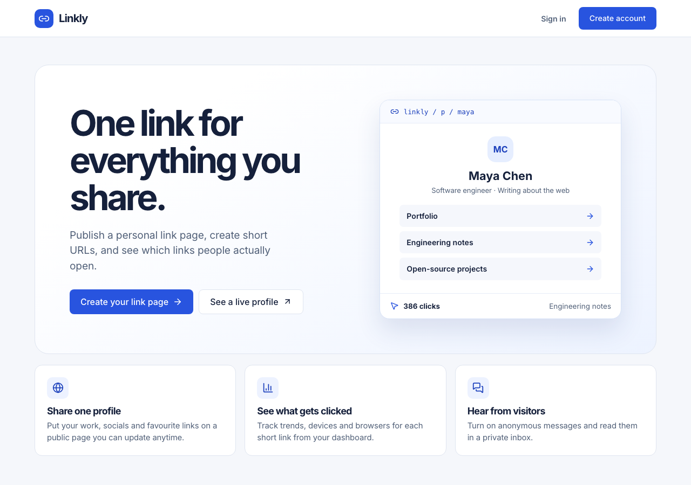

# Linkly

**A shareable link page with short URLs and click analytics.**

Linkly gives creators, students, and independent builders one place to share their work. Publish a profile with your important links, shorten individual URLs, and see what visitors open. A private inbox receives messages when you enable them on your public page.

[Open Linkly](https://linkly-plum.vercel.app) · [View a public profile](https://linkly-plum.vercel.app/p/adocxwork) · [Browse the REST API](https://linkly-amwf.onrender.com/swagger-ui/index.html)

[](https://github.com/adocxwork/linkly/actions/workflows/ci.yml)



## Try it

1. Create an account and add a destination from **Dashboard**. You’ll get a short URL you can copy immediately.
2. Choose **View public profile ↗** to open your shareable page in a new tab. Use **Settings** to edit your bio, enable messages, or add a UPI payment QR code.
3. Open the short URL in a browser, then select **Analytics** on that link to see the click count and breakdown. New events can take a few seconds to appear.

The hosted backend may take a minute or two to wake after inactivity.

## How the backend handles a click

| Design | Why it matters |
| --- | --- |
| Indexed PostgreSQL lookup, followed by an HTTP 302 | Updated destinations, disabled links, and suspended accounts take effect without waiting for a cache to expire. |
| Redis Streams and a scheduled consumer | A redirect can finish while the analytics worker stores click events in batches. |
| Event IDs, a single SQL transaction, and acknowledgement after commit | Replaying a queued event can’t double-count the click. |
| Circuit breaker and bounded local queue | Redirects keep working when Redis is unavailable. The in-memory fallback can lose buffered clicks on restart. |
| Account UUID and token version in each JWT | Password changes, suspension, and signing out everywhere revoke older tokens. |

**Stack:** Java 21, Spring Boot, PostgreSQL, Redis Streams, React, Flyway, and Docker. Hosted on Render, Supabase, Upstash, and Vercel.

## Run locally

Use Java 21, Node 22.13+, and PostgreSQL. Redis is optional.

```bash
cp .env.example .env
# Set DB_USERNAME, DB_PASSWORD, and JWT_SECRET in .env
createdb linkly
npm --prefix frontend ci
./run.sh
```

Use `openssl rand -hex 32` for a development JWT secret. Open [localhost:5173](http://localhost:5173) for the app or [localhost:8080](http://localhost:8080/swagger-ui/index.html) for the API explorer. Flyway applies the migrations on startup. Set `ADMIN_PASSWORD` to create the initial admin account.

```bash
./mvnw verify
npm --prefix frontend run lint
npm --prefix frontend run build
```

Backend integration tests use Docker or a disposable PostgreSQL database supplied through `TEST_DB_URL`. The suite covers account and link flows, redirects, inbox pagination, and replay-safe analytics.

[Project documentation](PROJECT_DOCUMENTATIONS.md) covers the request lifecycle, database, deployment, and interview walkthrough.
