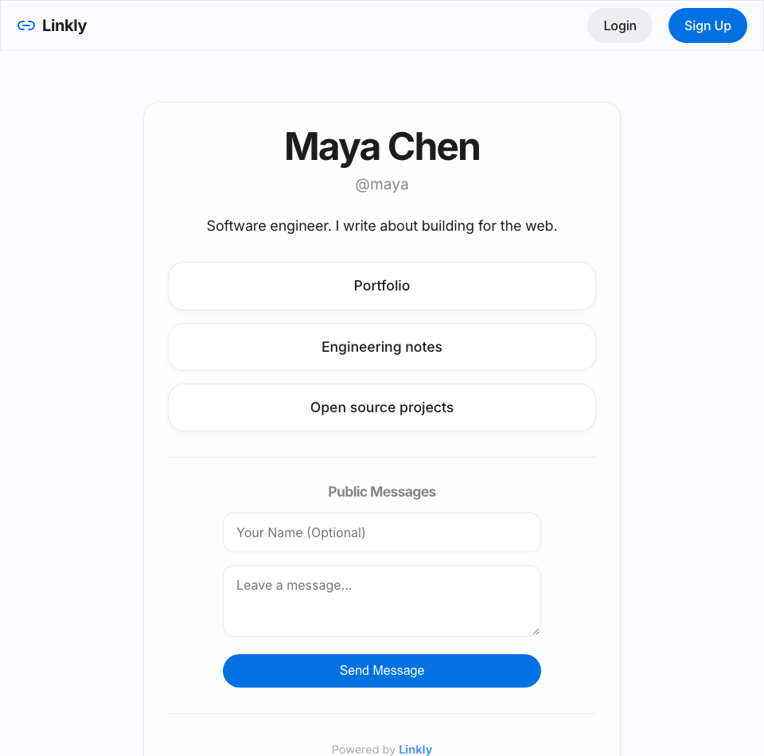
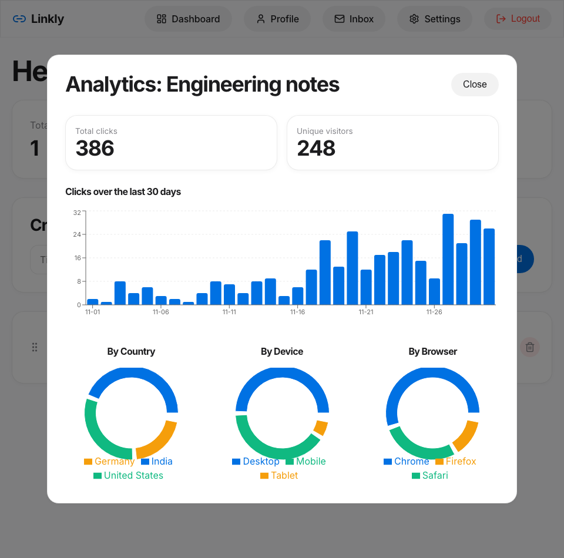
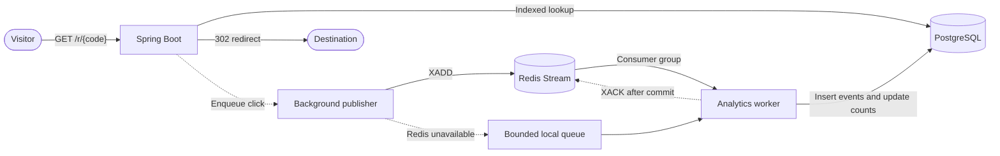

<div align="center">
  
  <h1>Linkly</h1>
  <p><strong>One public page for your links. Click analytics behind every short URL.</strong></p>
  <p>
    <a href="https://linkly-plum.vercel.app/p/adocxwork">Public profile</a> ·
    <a href="https://linkly-plum.vercel.app/register">Try Linkly</a> ·
    <a href="https://linkly-amwf.onrender.com/swagger-ui/index.html">Explore the API</a>
  </p>
  <a href="https://github.com/adocxwork/linkly/actions/workflows/ci.yml"></a>
</div>

<br>

<p align="center">
  
  
</p>
<p align="center"><em>Public profile and per-link analytics with sample data</em></p>

Linkly combines a link-in-bio page, a URL shortener and an analytics dashboard. Creators can reorder links, receive anonymous messages and optionally show a UPI QR code. The dashboard shows click trends, device and browser breakdowns, and estimated unique visitors.

**Stack** · Java 21 · Spring Boot · PostgreSQL · Redis Streams · React · Flyway · Docker

## What happens when someone clicks?



| Design decision | What it buys |
| --- | --- |
| Resolve redirects from PostgreSQL | A single indexed lookup checks the link and its owner. Deactivation and suspension take effect without relying on cache invalidation. |
| Process clicks off the request thread | The visitor gets the redirect while the worker handles persistence in batches. |
| Count an event once across retries | The event UUID identifies the row, and only first-time inserts increment the aggregate counter in the same transaction. |
| Keep redirects working during Redis outages | The breaker limits failed calls and analytics uses a bounded in-memory queue while Redis recovers. |
| Validate sessions against account state | JWTs carry the account UUID and token version so global logout, password changes and suspension revoke older tokens. |

The admin dashboard shows PostgreSQL readiness, Redis connectivity, stream backlog and dropped click counts. The demo runs on **Vercel** and **Render** with **Supabase** and **Upstash**. The first request after Render idles can take a minute or two.

## Start here in the code

| If you’re curious about… | Read this |
| --- | --- |
| URL validation, ownership and redirects | [LinkService.java](src/main/java/com/gupta/linkly/service/LinkService.java) |
| Consumer groups, acknowledgements and retries | [ClickStreamWorker.java](src/main/java/com/gupta/linkly/analytics/ClickStreamWorker.java) |
| Idempotent SQL and transactional counters | [ClickBatchWriter.java](src/main/java/com/gupta/linkly/analytics/ClickBatchWriter.java) |
| Token validation and revocation | [JwtAuthenticationFilter.java](src/main/java/com/gupta/linkly/security/JwtAuthenticationFilter.java) |
| Schema and database constraints | [Flyway migrations](src/main/resources/db/migration) |

## Run it locally

Install Java 21, Node 22.13+ and PostgreSQL. Redis is optional.

```bash
cp .env.example .env
# Set DB credentials and a JWT_SECRET of at least 32 bytes in .env
createdb linkly
npm --prefix frontend ci
./run.sh
```

Open [the local app](http://localhost:5173) or [the local Swagger UI](http://localhost:8080/swagger-ui/index.html). Flyway creates the tables on startup. Set `ADMIN_PASSWORD` before launch if you want an admin account.

```bash
./mvnw verify
npm --prefix frontend run lint
npm --prefix frontend run build
```

The PostgreSQL integration tests use Testcontainers or a disposable database supplied via `TEST_DB_URL`. They cover schema migration, signup, redirects, inbox pagination and replay-safe click counts.

**Scope:** Linkly runs as a single backend instance. Queued clicks can be lost during a restart or a prolonged backlog. IP-based visitor estimates have limits.

[Architecture and trade-offs](docs/ARCHITECTURE.md) · [Deploy and troubleshoot](docs/DEPLOYMENT.md)
