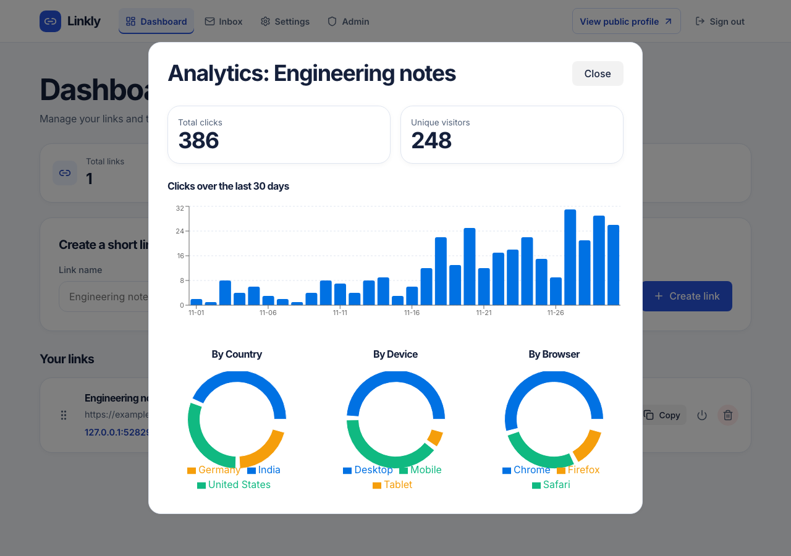

<div align="center">
  
  <h1>Linkly</h1>
  <p><strong>A public home for your links, with analytics for each short URL.</strong></p>
  <p>
    <a href="https://linkly-plum.vercel.app"><strong>Open the app</strong></a> ·
    <a href="https://linkly-plum.vercel.app/p/adocxwork">View a public profile</a> ·
    <a href="https://linkly-amwf.onrender.com/swagger-ui/index.html">Explore the API</a> ·
    <a href="PROJECT_DOCUMENTATIONS.md">Read the docs</a>
  </p>
  <a href="https://github.com/adocxwork/linkly/actions/workflows/ci.yml">
    
  </a>
</div>

Linkly brings together three jobs that often need separate tools. Publish a page for your work, make individual links easy to share, and see which links visitors open. You can also receive anonymous messages in a private inbox and add an optional UPI payment QR to your profile.

<p align="center">
  <a href="assets/linkly-home.png"></a>
  <a href="assets/linkly-analytics.png"></a>
</p>
<p align="center"><em>Linkly homepage and per-link analytics with sample data</em></p>

## Explore the demo

1. **View a profile.** Open the public page without an account.
2. **Create a short link.** Sign up, paste a destination into the dashboard, and open the resulting URL in a regular browser.
3. **See the click arrive.** Open the link’s **Analytics** panel after a few seconds. Use **Settings** to edit your profile and choose whether visitors can send messages.

The hosted backend can take a minute or two to wake after inactivity.

## From redirect to dashboard

A visitor shouldn’t have to wait for an analytics write. Spring Boot checks the link and its owner in PostgreSQL, returns a temporary redirect, and hands the click to a background publisher. The worker reads from Redis Streams, stores a batch in PostgreSQL, and acknowledges it after the database commits.

| What Linkly handles | How it works |
| --- | --- |
| A link is disabled | Redirects check the current database state, including account suspension. |
| A click is delivered again | The event UUID identifies the row. Only newly inserted events increment the link counter in the same transaction. |
| Redis goes offline | A circuit breaker limits retries and a bounded in-memory queue collects clicks while capacity lasts. A restart can lose that buffered work. |
| A session is revoked | Tokens carry the account UUID and version. The API checks the current account and scopes private queries to that UUID. |

**Built with** Java 21 · Spring Boot · PostgreSQL · Redis Streams · React · Flyway · Docker. The public demo uses Render, Vercel, Supabase, and Upstash.

## Run locally

You’ll need Java 21, Node 22.13 or later, and a running PostgreSQL instance. Redis is optional.

```bash
cp .env.example .env
createdb linkly
npm --prefix frontend ci
```

Set the PostgreSQL credentials and `JWT_SECRET` in `.env`. Use `openssl rand -hex 32` to generate a development secret. Then run `./run.sh` on macOS or Linux.

| Open | URL |
| --- | --- |
| App | [localhost:5173](http://localhost:5173) |
| Swagger UI | [localhost:8080/swagger-ui/index.html](http://localhost:8080/swagger-ui/index.html) |

Flyway creates the schema on startup. Set `ADMIN_PASSWORD` before starting if you want to use the admin panel.

## Verify the project

```bash
./mvnw verify
npm --prefix frontend run lint
npm --prefix frontend run build
```

The integration suite checks migrations, redirects, account isolation, inbox pagination, and replay-safe counters on PostgreSQL. Run Docker for Testcontainers or point `TEST_DB_URL` at a disposable database.

[Project documentation](PROJECT_DOCUMENTATIONS.md) explains the API, schema, deployment settings, and failure behavior.
