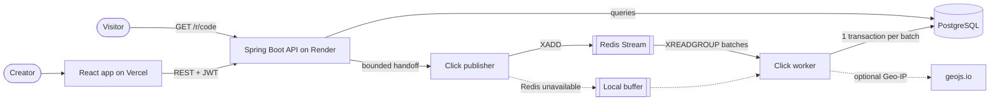

# Linkly

[](https://github.com/adocxwork/linkly/actions/workflows/ci.yml)

A link-in-bio and URL-shortener platform. Creators get a public page (`/p/{username}`) with their
links, an optional UPI payment QR code and an anonymous message box. Short links
(`/r/{code}`) record device, browser, estimated unique visitors and a 30-day trend. Country enrichment is optional.

**Hosted demo:** [linkly-plum.vercel.app](https://linkly-plum.vercel.app) ·
**API docs:** [Swagger UI](https://linkly-amwf.onrender.com/swagger-ui/index.html)

## Tech stack

| Layer | Technology | Hosted on |
|---|---|---|
| Backend | Java 21, Spring Boot 4.1 (Web MVC, Security, Data JPA), Flyway, Bucket4j, JJWT | Render (Docker) |
| Database | PostgreSQL | Supabase |
| Click queue | Redis Streams, optional | Upstash |
| Frontend | React 19, Vite, Recharts | Vercel |
| Tests / CI | JUnit 5, Mockito, Testcontainers, GitHub Actions | |

## Architecture



### Engineering decisions

1. **One indexed redirect lookup.** PostgreSQL verifies that the link and owner can be served. The redirect returns `302` with `Cache-Control: no-store` and hands off click processing in the background.
2. **Idempotent analytics writes.** The event UUID is the row’s primary key. PostgreSQL inserts a batch and increments counters for newly inserted rows in one transaction. The worker acknowledges Redis only after the database commit.
3. **Bounded fallback when Redis is unavailable.** A circuit breaker limits repeat calls to a failing Redis, and clicks use a bounded local queue while it recovers. The worker polls on a publish signal and on a periodic sweep to limit idle commands.
4. **Revocable bearer tokens.** JWTs use the account UUID and token version. Password changes, suspension and logging out everywhere revoke earlier tokens.
5. **Migrations and health checks.** Flyway manages the schema. Login checks database readiness and shows a cold-start message while the backend wakes.

See the [interview guide](docs/ARCHITECTURE.md) and [deployment guide](docs/DEPLOYMENT.md).

## Admin features

The admin dashboard shows **live system health**, refreshed every 30 s:
- PostgreSQL: latency and connection pool
- Redis: ping latency and circuit breaker state
- Click pipeline: mode, stream length and pending count, processed, dropped and malformed record counts
- Geo-IP API, self-ping and JVM memory

It also has **runtime switches** for the Render self-ping and for Redis. Both are stored in the
database, so they survive restarts. Admins can also suspend or delete users.

## Running locally

Prerequisites: Java 21, Node 22, PostgreSQL. Redis is optional.

```bash
cp .env.example .env      # set JWT_SECRET and DB credentials
npm --prefix frontend ci
createdb linkly
./run.sh                  # backend :8080, frontend :5173
```

Flyway creates the schema on first start. Set `ADMIN_PASSWORD` in `.env` to get an `admin` account.

## Tests

```bash
./mvnw test
```

- **Unit tests:** circuit breaker, click publisher fallback, stream acknowledgement, retry and legacy record handling,
  client-IP resolution, User-Agent parsing, and the link/user services.
- **Integration tests:** run against PostgreSQL with Redis disabled. Cover migrations, the register-to-redirect flow, inbox pagination, replay-safe counters, account recreation and admin health. Use Docker or set `TEST_DB_URL` (and credentials if needed) to a disposable, empty database.

CI (GitHub Actions) runs the backend tests and the frontend lint and build on every push.

## API overview

| Method | Path | Auth |
|---|---|---|
| POST | `/api/auth/register`, `/api/auth/login` | public (10/min per IP) |
| GET | `/api/public/u/{username}` | public (60/min per IP) |
| POST | `/api/public/u/{username}/messages` | public (5/min per IP) |
| GET | `/r/{code}` | public (120/min per IP) |
| CRUD | `/api/links`, `/api/links/{id}/analytics`, `/api/links/reorder` | user |
| GET/PUT | `/api/users/profile`, `/api/users/settings`; POST `/api/users/me/revoke-sessions` | user |
| GET/DELETE | `/api/messages` | user |
| GET/PUT | `/api/admin/users…`, `/api/admin/system/health`, `/api/admin/system/settings` | admin |
| GET | `/actuator/health` (`/liveness`, `/readiness`) | public, no details |

## Known limitations / next steps

- The app is designed for one instance. Buffered clicks can be lost on restart or under prolonged outages. The Redis path still needs a live provider integration test.
- Redirect latency depends on PostgreSQL and network distance. Analytics queries scan historical rows, and IP-based unique visitors are an estimate.
- Public registration and anonymous messaging need moderation and stronger abuse controls before broad exposure. Email verification and password recovery are absent.
- The free Render service can sleep. A short link that triggers a cold start depends on Render’s response, while the login page can display progress and retry.
